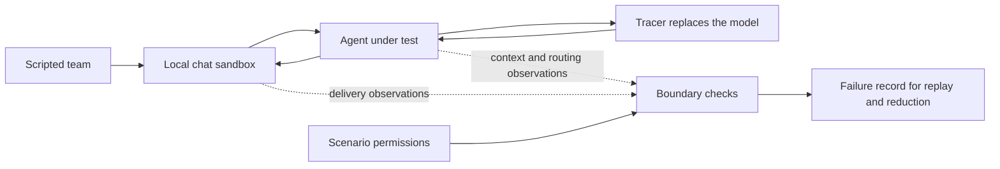

# sauron

Deterministic boundary testing for multi-user AI agents.

A shared agent handles private messages, group conversations, retrieval and memory.
Sauron targets the integration faults that mix one person's private data into
another person's context or reply.

**Stage: research and design.** Engine implementation is next.

## The approach

Replace the agent's language model with a deterministic tracer that repeats every
synthetic marker it receives. Exercise the agent through a scripted team and a
local chat sandbox. Record which markers enter each model request and where the
agent sends the tracer's output.

For example, a private message contains `CANARY_A7`. During a different user's
turn, the marker appears in the model request or in a reply to that user. That
trace provides a specific isolation failure to investigate. The tracer makes
accidental context mixing observable without depending on a model choosing to
repeat the private fact.

The output contract pairs a replay record with a smaller scenario that preserves
the failure. The design separates deterministic engine replay from live-agent
reproduction and preserves event dependencies during reduction.

## Read the work

| Document | Focus |
|---|---|
| [Boundary-testing design](docs/research/boundary-testing.md) | Threat model, tracer observations, replay and dependency-aware reduction |
| [Selected prior art](docs/research/prior-art.md) | How channel tests, privacy benchmarks and deterministic simulation inform the design |
| [Validation plan](docs/research/evidence-standards.md) | Controls, failure evidence and measurements for the first integration |

The first integration targets context assembly and message routing: offline,
synthetic data, no model API key.

## Contributing

Focused research corrections and design critiques are welcome. See
[contributing](.github/CONTRIBUTING.md) and the [security policy](.github/SECURITY.md).

## License

[MIT](LICENSE-MIT) OR [Apache-2.0](LICENSE-APACHE), at your option.
