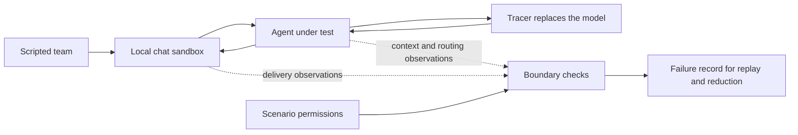

# sauron

Deterministic boundary testing for AI agents that serve multiple people.

A shared agent handles private messages, group conversations, retrieval and memory.
Sauron asks a concrete question: **can one person's private data reach another
person's context or reply?**

**Status: research and design.** The test method is specified below; the engine
and integrations are not implemented yet.

## The approach

Replace the agent's language model with a deterministic tracer that repeats every
synthetic marker it receives. Exercise the agent through a scripted team and a
local chat sandbox. Record which markers enter each model request and where the
agent sends the tracer's output.

For example, a private message contains `CANARY_A7`. During a different user's
turn, the marker appears in the model request or in a reply to that user. That
trace provides a specific isolation failure to investigate. The tracer makes
accidental context mixing observable without depending on a model choosing to
repeat the private fact.

The intended output is a replay record and a smaller valid scenario that preserves
the failure. Exact replay depends on controlling the relevant inputs and state;
a seed alone does not make an arbitrary external agent deterministic.

## Read the work

| Document | Focus |
|---|---|
| [Boundary-testing design](docs/research/boundary-testing.md) | Threat model, tracer observations, controls, replay and reduction limits |
| [Selected prior art](docs/research/prior-art.md) | Existing channel tests, privacy benchmarks and deterministic testing; the specific question left to evaluate |
| [Evidence and validation](docs/research/evidence-standards.md) | What would justify a finding, how to test the checker, and what must be measured before making broader claims |

The first goal is an offline test of context assembly and message routing, with
synthetic data and no model API key. Semantic privacy, paraphrase leakage and
predictions of real team behavior require different evidence.

## Contributing

Focused research corrections and design critiques are welcome. See
[contributing](.github/CONTRIBUTING.md) and the [security policy](.github/SECURITY.md).

## License

[MIT](LICENSE-MIT) OR [Apache-2.0](LICENSE-APACHE), at your option.
